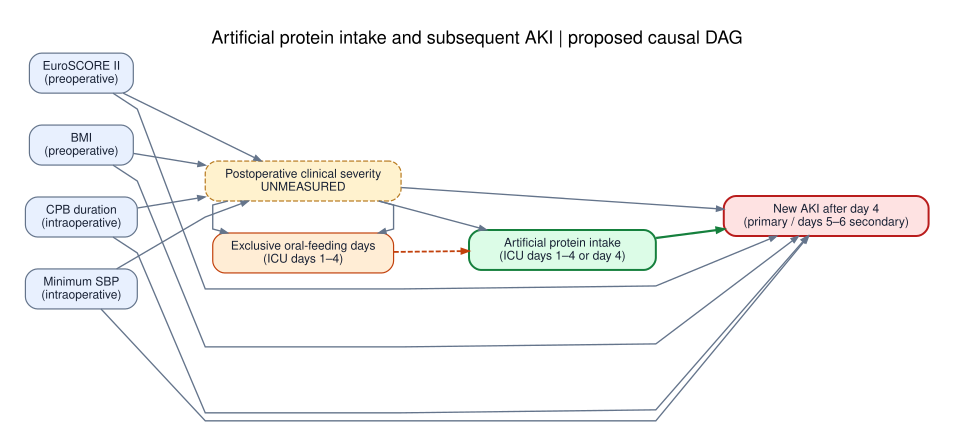

<!-- All bracketed values are placeholders, not estimated results. -->
<!-- For this presentation, the slide ending with DISCUSSION should remain the LAST slide. -->

## Protein Intake and Acute Kidney Injury After Major Cardiac Surgery {background-color="#13223b" .title-slide}

::: {.title-inner}
### An observational post-hoc analysis of the SUSTAIN CSX trial

**Fortgeschrittenes Praxisprojekt · LMU Munich**

December 4, 2026

[Team members] · Project partner: Wolfgang Hartl
:::

## Does protein intake during acute ICU care relate to later AKI?

::: {.columns}
::: {.column width="55%"}
### Clinical motivation

- Acute kidney injury (AKI) is an important complication after major cardiac surgery.
- The optimal protein dose in critically ill patients remains debated.
- We study a selected subgroup of the **SUSTAIN CSX** trial, with ICU stay ≥ 4 days.
:::
::: {.column width="45%"}
::: {.question-panel}
**OUR RESEARCH QUESTION**

Is **artificial protein intake during ICU days 1–4** associated with **new AKI after day 4**?
:::
:::
:::

::: {.source-line}
*Study design:* Post-hoc observational protein analysis; protein was prescribed by clinicians, **not randomized**. Sources: Project proposal, pp. 1–2; project partner's answers; @stoppe2023.
:::

## We use two exposure measures and two definitions of AKI

::: {.columns}
::: {.column width="50%"}
::: {.panel}
### Exposure: artificial protein intake

**Average intake** over ICU days 1–4

**Day-4 intake** on ICU day 4

Unit: **g/kg body weight/day** — *verify the averaging and denominator in the local data documentation*.
:::
:::
::: {.column width="50%"}
::: {.panel}
### Outcomes: new AKI

**Primary** — New AKI after ICU day 4, until ICU discharge alive or death.

**Secondary** — New AKI on ICU days 5–6.

Both outcomes: **binary (yes/no)**.
:::
:::
:::

::: {.source-line}
Outcome windows: Project proposal, p. 2. Artificial protein was a clinician-directed nutritional supplement: project partner's answers.
:::

## Clinical risk and postoperative severity may confound the association

{fig-alt="Working DAG for artificial protein intake and AKI, including EuroSCORE II, BMI, CPB duration, minimum intraoperative SBP, exclusive oral feeding, and unmeasured postoperative severity." .dag-image}

::: {.compact-note}
**Measured adjustment candidates:** EuroSCORE II · BMI · CPB duration · minimum intraoperative SBP. **Oral feeding (days 1–4)** requires special care because it overlaps the protein exposure period. **Postoperative clinical severity is not directly measured.**
:::

::: {.source-line}
*Working causal assumptions, not established causal effects.* DAG source: project discussions and accompanying `dag_source.R`.
:::

## We examine the analysis sample, AKI, deaths and missingness

::: {.columns}
::: {.column width="69%"}
| Patient characteristic | n |
|:--|--:|
| Patients included in the analysis | **[N]** |
| New AKI after day 4 (primary) | [n] |
| New AKI on days 5–6 (secondary) | [n] |
| Died during ICU stay | [n] |
| Died in ICU **without** new AKI | [n] |
| Survived ICU without new AKI | [n] |
:::
::: {.column width="31%"}
::: {.panel}
### Missing data

Some exposure and/or covariate values are missing.

**[x / N]** patients have missing **[variable(s)]**.

Report **model-specific n** for comparisons.
:::
:::
:::

::: {.source-line}
*Replace placeholders with counts from your restricted analysis population; distinguish the AKI definitions.* A documented zero protein intake is not the same as missing intake.
:::

## Artificial protein intake varies between patients

::: {.plot-slot}

DENSITY PLOT

Replace with a density plot from the local analysis

X-axis: Average artificial protein intake (g/kg/day) · Y-axis: Density

:::

::: {.takeaway}
**Describe the observed pattern:** [concentration / skewness / variation / outliers]. Very low values may reflect supplemental artificial feeding rather than complete nutritional replacement.
:::

::: {.source-line}
*Do not interpret the placeholder as data.* The project partner confirmed that artificial nutrition could be supplementary.
:::

## We estimate crude and clinically adjusted logistic models

::: {.columns}
::: {.column width="50%"}
::: {.panel}
### Main analyses

- **Two exposures:** average days 1–4; day 4
- **Two outcomes:** primary; secondary AKI
- **Two models:** crude; adjusted
- **Estimate:** odds ratio (OR) with 95% CI
:::
:::
::: {.column width="50%"}
::: {.panel}
### Adjusted specification

**Candidate covariates**

EuroSCORE II, BMI, CPB duration, minimum intraoperative SBP.

**Investigate separately:** days on exclusive oral feeding.

**Report:** sample size and protein-unit increment.
:::
:::
:::

::: {.formula-line}
logit[P(AKI = 1)] = β₀ + β₁ × artificial protein intake + γᵀ × covariates
:::

::: {.source-line}
Adjusted models describe conditional **associations**, not randomized treatment effects. Covariate inclusion requires a justified causal and temporal interpretation.
:::

## Eight estimates summarize our main logistic analyses

::: {.plot-slot .forest-slot}

OutcomeExposureCrude OR (95% CI)Adjusted OR (95% CI)

PrimaryAverage, days 1–4[estimate; CI][estimate; CI]

PrimaryDay 4[estimate; CI][estimate; CI]

SecondaryAverage, days 1–4[estimate; CI][estimate; CI]

SecondaryDay 4[estimate; CI][estimate; CI]

Replace the comparison table with your final 8-row forest plot (OR, 95% CI, reference line OR = 1).

:::

::: {.takeaway}
**Interpret:** effect direction and size · confidence interval width · what changes after adjustment · consistency of average and day-4 exposures.
:::

## Stratification explores heterogeneity across patient groups

::: {.columns}
::: {.column width="46%"}
### Planned exploratory analyses

- Stratification variable(s): **[state subgroup(s)]**
- Compare protein–AKI associations **within** strata.
- Report subgroup-specific **n**, AKI events, OR and 95% CI.
- Consider formal interaction terms when scientifically motivated.
:::
::: {.column width="54%"}
::: {.plot-slot .short-slot}
**STRATIFIED FOREST PLOT**

[Insert local subgroup model output]
:::
:::
:::

::: {.source-line}
Avoid concluding that groups differ merely because one subgroup is statistically significant and another is not. Small event counts may produce unstable estimates.
:::

## Two sensitivity analyses test different assumptions

::: {.columns}
::: {.column width="50%"}
::: {.panel}
### Oral feeding (ICU days 1–4)

**Concern:** Artificial protein administration is linked to feeding ability and clinical condition.

**Analysis:** [specify the oral-feeding sensitivity model or restriction].

**Result:** [direction and magnitude of change].
:::
:::
::: {.column width="50%"}
::: {.panel}
### Death before new AKI

**Concern:** Death prevents subsequent observation of AKI.

**Worst case:** Recode ICU deaths without new AKI as AKI events.

**Result:** [compare original and recoded estimates].
:::
:::
:::

::: {.source-line}
Worst-case recoding follows the project proposal and partner response. It is **not** a formal competing-risks analysis; time-to-event methods require suitable event and follow-up timing.
:::

## What do the analyses imply for the research question?

::: {.result-stack}
::: {.result-item}
**Primary outcome — AKI after day 4**

[Summarize adjusted estimate, direction, magnitude, uncertainty, and whether average/day-4 measures agree.]
:::
::: {.result-item}
**Secondary outcome — AKI on days 5–6**

[Explain whether the shorter outcome window supports or contrasts with the primary finding.]
:::
::: {.result-item}
**Role of oral feeding and sensitivity analyses**

[Explain whether accounting for oral feeding or reclassifying deaths changes the interpretation.]
:::
:::

::: {.takeaway}
**Answer:** [One cautious sentence about the *association*, not a proven causal effect.]
:::

## Three open questions for discussion

::: {.discussion-grid}
::: {.discussion-item}
### 01 · Death as a competing event

How should we handle patients who **die without developing AKI**? Is worst-case recoding sufficient as a sensitivity analysis?
:::
::: {.discussion-item}
### 02 · What does oral feeding tell us?

Does exclusive oral feeding primarily indicate **nutrition strategy**, **clinical recovery**, or both? Should we adjust for it?
:::
::: {.discussion-item}
### 03 · Residual confounding

We cannot directly observe **postoperative clinical severity**. Are our clinical covariates adequate proxies, or could important confounding remain?
:::
:::

::: {.discussion-bottom}
**Questions for peers and supervisors:** Are our causal assumptions, adjusted model and sensitivity analyses defensible?
:::
